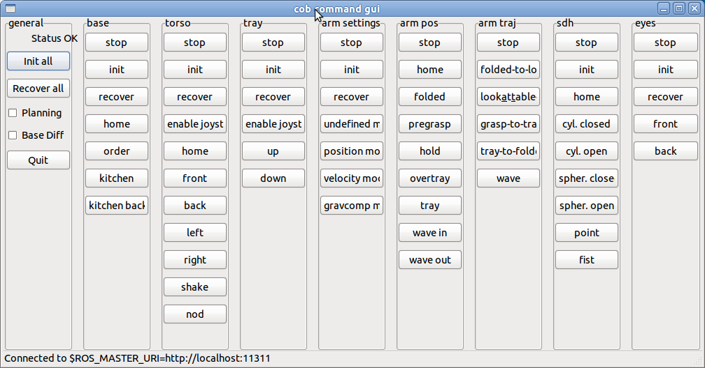

## Hardware Requirements

To use this package you don't need any hardware, but it is intended to
be used with either a real Care-O-bot or a simulated one (see
[cob_bringup](https://index.ros.org/p/cob_bringup) or
[cob_bringup_sim](https://index.ros.org/p/cob_bringup_sim)).

## ROS API

The cob_command_gui package provides a
configurable node for operating different hardware parts of Care-O-bot.
The command_gui uses the functionalities of the
[cob_script_server](https://index.ros.org/p/cob_script_server) package.

### knoeppkes.py

The `knoeppkes.py` is configurable by a .yaml file to send
[topics](Topics) and [services](Services). Inside the command_gui mainly
[actionlib](https://index.ros.org/p/actionlib) calls are used.

## Usage/Examples

Building 

```
rosdep install cob_command_gui
rosmake cob_command_gui
```

 For starting the command_gui


```
export ROBOT=cob3-3
export ROBOT_ENV=ipa-kitchen
roslaunch cob_bringup dashboard.launch
```

 The parameters of the command_gui are defined
in
[cob_default_env_config](https://index.ros.org/p/cob_default_env_config)
and
[cob_default_robot_config](https://index.ros.org/p/cob_default_robot_config)
and loaded in the parameter server.
